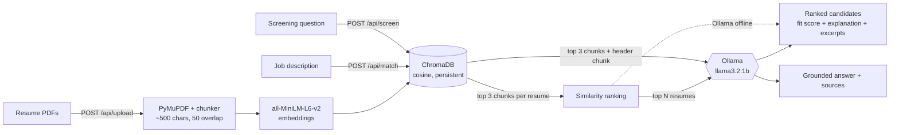

# Resume Screener

Embeds resumes and a job description, searches them in a vector database, and uses a local LLM to score and explain the closest candidate matches.


Upload resume PDFs, paste a job description, and get a ranked list of candidates with a fit score, a short explanation, and the exact resume excerpts behind it. Everything runs on your machine: the embedding model and the LLM are local, so resume data never leaves it. Built without orchestration frameworks (no LangChain or LlamaIndex). Each pipeline stage is a small, readable module.

## What it does

| Feature | Endpoint | What you get |
|---|---|---|
| **Rank candidates for a job** | `POST /api/match` | Every indexed resume is searched with the job description. The closest ones get a 0-10 fit score and an explanation, with the matching excerpts attached. |
| **Ask about one resume** | `POST /api/screen` | An answer grounded only in that resume's text, plus the excerpts it used. Replies "Not found in the resume." when the text doesn't say. |
| **Extract a profile** | `POST /api/extract` | Name, skills and projects as structured JSON. |

## How ranking works

1. **Index.** PyMuPDF extracts the text, a custom chunker splits it (~500 characters, 50 overlap, preferring paragraph then sentence breaks), and `all-MiniLM-L6-v2` embeds each chunk into a persistent ChromaDB collection.
2. **Search.** The job description is embedded as a query. For each resume, the 3 chunks closest to it are retrieved. A resume's similarity is `1 - mean cosine distance` of those chunks.
3. **Score.** The top `top_n` resumes (default 5) are sent to a local Ollama model, one at a time, with the job description and their matched excerpts. The model returns a 0-10 fit score and a short explanation.
4. **Rank.** Final order is the LLM fit score, with vector similarity breaking ties. If Ollama is unreachable, the order is vector similarity alone and the response says `"ollama_used": false`.

Vector search is cheap and narrows the field. The LLM, which costs one generation per candidate, only sees the shortlist.

## Architecture



## Tech stack

| Layer | Choice |
|---|---|
| API | FastAPI, Pydantic |
| PDF parsing | PyMuPDF |
| Embeddings | sentence-transformers `all-MiniLM-L6-v2` |
| Vector store | ChromaDB (persistent, cosine distance) |
| LLM | Ollama, `llama3.2:1b` by default (`OLLAMA_MODEL` to change) |
| Frontend | Single HTML file, Bootstrap 5, vanilla JS |
| Packaging | Docker (CPU-only PyTorch, embedding model baked in) |

## Quick start

Requires Python 3.13 and [Ollama](https://ollama.com/download).

```bash
# 1. Python environment
python -m venv venv
source venv/bin/activate          # Windows: venv\Scripts\activate
pip install -r requirements.txt

# 2. Ollama (separate terminal). Skip `ollama serve` if the desktop app is already running.
ollama serve
ollama pull llama3.2:1b

# 3. API + UI
uvicorn app.main:app --reload --port 8000
```

Open http://localhost:8000. The embedding model (~90 MB) downloads automatically the first time a resume is indexed. Interactive API docs are at `/docs`.

| Variable | Default |
|---|---|
| `OLLAMA_URL` | `http://localhost:11434/api/generate` |
| `OLLAMA_MODEL` | `llama3.2:1b` |

### Docker

```bash
docker build -t rag-resume-screener .

# Retrieval only (no Ollama)
docker run --rm -p 8000:8000 rag-resume-screener

# With Ollama running on the host machine
docker run --rm -p 8000:8000 \
  --add-host=host.docker.internal:host-gateway \
  -e OLLAMA_URL=http://host.docker.internal:11434/api/generate \
  rag-resume-screener
```

The container runs as a non-root user and listens on `$PORT` if set, otherwise 8000.

## API example

Upload a resume, then rank everything indexed against a job description (`top_n` is optional, 1-10, default 5):

```bash
curl -X POST http://localhost:8000/api/upload -F "file=@resume.pdf"

curl -X POST http://localhost:8000/api/match \
  -H "Content-Type: application/json" \
  -d '{"job_description": "Senior backend engineer: Python, FastAPI, PostgreSQL, Kubernetes.", "top_n": 3}'
```

```json
{
  "matches": [
    {
      "rank": 1,
      "resume_id": "27236157-6ae9-4b42-b038-fc26d583619a",
      "filename": "resume.pdf",
      "name": "Jordan Example",
      "similarity": 0.54,
      "llm_score": 8,
      "explanation": "Five years of Python with FastAPI and Kubernetes deployment experience; no PostgreSQL mentioned.",
      "sources": [
        {"text": "Infrastructure: Owned Kubernetes deployment pipelines ...", "distance": 0.41, "chunk_index": 2}
      ]
    }
  ],
  "resumes_searched": 4,
  "ollama_used": true
}
```

Response values are illustrative. `llm_score` is `null` when Ollama is unavailable or its answer for that candidate couldn't be parsed, and unscored candidates sort below scored ones. `name` is the first line of the resume, so it is only as good as the resume's layout. On Windows PowerShell, call `curl.exe` instead of `curl`.

Errors: `400` for non-PDF, empty or unreadable files, `413` over 10 MB, `422` for PDFs with no text layer or invalid bodies (including a blank job description), `404` for an unknown `resume_id` or when no resumes are indexed.

## Design decisions

- **No orchestration frameworks.** PDF parsing, chunking, embedding, prompts and LLM calls are direct calls to PyMuPDF, ChromaDB, sentence-transformers and Ollama's HTTP API.
- **The header chunk is always included.** Names and contact lines are sparse text that embedding search ranks poorly, even for "what is the candidate's name?". Chunk 0 is fetched by metadata and prepended to every screening answer instead of relying on similarity.
- **Degrades instead of failing.** If Ollama is down, screening returns the retrieved chunks and matching returns a vector-similarity ranking, each flagged with `ollama_used: false`.
- **Grounded prompts.** Temperature 0, answers restricted to the retrieved excerpts, and an exact fallback reply when the text doesn't contain the answer. The matching prompt tells the model to treat the job description and resume text as data and ignore instructions inside them. That reduces prompt-injection risk from uploaded resumes but does not eliminate it.
- **Untrusted content stays out of the DOM as markup.** The UI renders resume text, model output and server messages with `textContent` only, never `innerHTML`.
- **Bounded uploads.** PDF only, 10 MB cap enforced while reading, so oversized bodies are never fully loaded.
- **Resume data stays out of git.** The Chroma store (`data/`) is git-ignored because it holds real resume content.

## Evaluation

```bash
python eval.py
```

`eval.py` indexes one hardcoded mock resume, runs 5 screening queries, and reports **Retrieval Hit-Rate @ 3**: the share of queries where at least one of the top-3 retrieved chunks contains the expected keyword.

Result: **5/5 = 100%**. The first result slot is always the resume header chunk, so a match shows up at rank 1 or 2.

This is a small synthetic check that the retrieval path works. It does not measure answer quality on real, messier resumes, and it does not cover `/api/match`. Candidate ranking has been checked by hand on mock resumes with a mocked and a live local model, but there is no labeled job-and-resume dataset or automated test suite for it yet, so no accuracy figure is claimed.

## Limitations

- **Small model.** Fit scores and explanations come from a 1B-parameter model and are coarse. In one manual test it said a candidate lacked Kubernetes when the resume mentioned it, although the ranking itself was right. Treat scores as a ranking aid and check the attached excerpts. A larger model via `OLLAMA_MODEL` should help.
- **Speed.** Scoring costs one Ollama call per shortlisted candidate, so a match request takes roughly `top_n` times one generation (about 32 seconds for 3 candidates on the development machine).
- **Long job descriptions.** The embedding model reads at most 256 tokens, so only the start of a long description steers the search. Put key requirements first.
- **No de-duplication.** Every upload gets a new ID, so uploading the same PDF twice creates two candidates.
- **Matching covers everything indexed.** There is no way to limit it to a subset or delete a resume through the API.
- **No authentication, and CORS allows all origins.** Fine for local use. Add both before exposing it, and don't upload real candidates' resumes to a shared instance.
- **Ephemeral storage on free hosts.** The Chroma store lives on the container filesystem, so a restart without a persistent disk loses indexed resumes. Retrieval-only mode used about 450 MB of RAM in Docker after one upload and one query, close to the 512 MB limit of small free tiers, and a local LLM does not fit there at all.
- **No OCR.** Scanned PDFs without a text layer are rejected.

## Possible next steps

1. Build a small labeled set of job descriptions and resumes, and measure ranking quality instead of eyeballing it.
2. De-duplicate uploads by content hash, and add delete and subset selection.
3. Compare `llama3.2:1b` against a larger local model on the same cases.
4. Add authentication, and tests for the API.

## Project layout

```
app/
  main.py              FastAPI app, CORS, static files, /health
  routers/screener.py  POST /api/upload, /api/screen, /api/extract, /api/match
  services/ingest.py   PDF extraction + chunking
  services/rag.py      ChromaDB indexing/retrieval, job matching, Ollama client
static/index.html      Single-page UI (Bootstrap 5, vanilla JS)
eval.py                Retrieval hit-rate evaluation
Dockerfile
```
